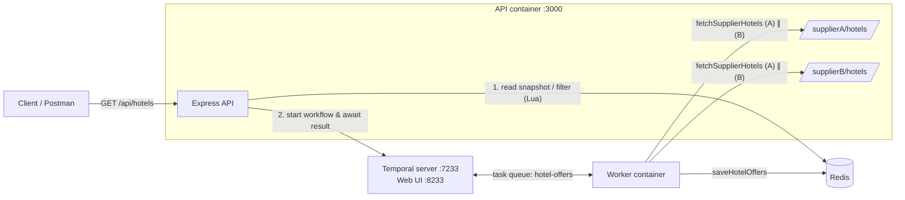
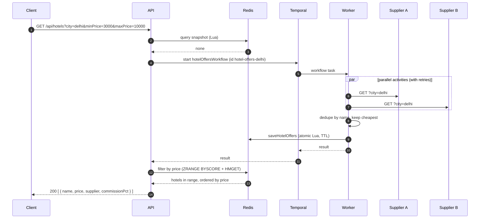
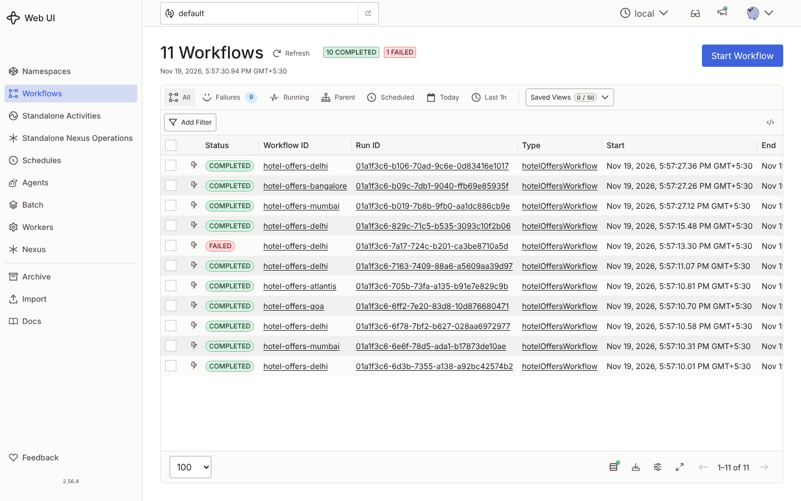
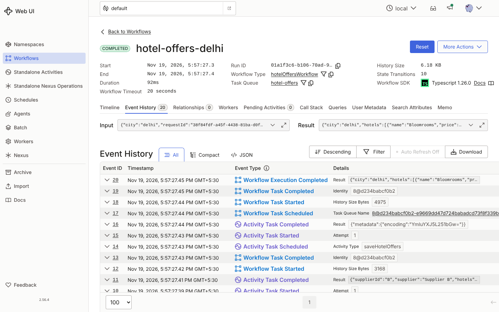

# Hotel Offer Orchestrator

Aggregates overlapping hotel offers from two (mock) suppliers, de-duplicates hotels by name, keeps the
best-priced offer for each, and lets clients filter the result by price range — with the comparison
orchestrated by **Temporal** and the price filtering done **inside Redis**.

**Stack:** Node.js 22 · TypeScript · Express 5 · Temporal (TypeScript SDK) · Redis 7 · Docker Compose

```bash
docker compose up --build -d --wait
curl "http://localhost:3000/api/hotels?city=delhi"
curl "http://localhost:3000/api/hotels?city=delhi&minPrice=3000&maxPrice=10000"
```

---

## Contents

- [Requirements checklist](#requirements-checklist)
- [Architecture](#architecture)
- [Quick start](#quick-start)
- [API reference](#api-reference)
- [How it works](#how-it-works)
- [Testing](#testing)
- [Local development (without Docker for the app)](#local-development-without-docker-for-the-app)
- [Configuration](#configuration)
- [Deployment](#deployment)
- [Project structure](#project-structure)
- [Design decisions & assumptions](#design-decisions--assumptions)
- [Troubleshooting](#troubleshooting)

---

## Requirements checklist

| Requirement                                                     | Where / how                                                                                                                                               |
| --------------------------------------------------------------- | --------------------------------------------------------------------------------------------------------------------------------------------------------- |
| `GET /api/hotels?city=delhi`                                    | [`src/api/routes/hotels.ts`](src/api/routes/hotels.ts)                                                                                                    |
| Temporal orchestrates the process                               | [`src/temporal/workflows.ts`](src/temporal/workflows.ts) — `hotelOffersWorkflow`                                                                          |
| Call Supplier A and B **in parallel**                           | `Promise.allSettled` over two `fetchSupplierHotels` activities                                                                                            |
| Deduplicate by name, keep the cheaper one; single-supplier kept | [`src/domain/select-best-offers.ts`](src/domain/select-best-offers.ts) (pure, deterministic, unit-tested)                                                 |
| Return the de-duplicated list in the given format               | Body is exactly `[{ name, price, supplier, commissionPct }]`                                                                                              |
| `GET /api/hotels?city=delhi&minPrice=&maxPrice=`                | Same endpoint, optional `minPrice` / `maxPrice` (inclusive, either can be omitted)                                                                        |
| De-duplicated list **saved in Redis**                           | `saveHotelOffers` activity → sorted set + hash per city ([`src/redis/hotel-cache.ts`](src/redis/hotel-cache.ts))                                          |
| Price filtering **inside Redis**                                | Lua script: `ZRANGE … BYSCORE` + `HMGET`, atomic, single round-trip                                                                                       |
| Mock `GET /supplierA/hotels`, `GET /supplierB/hotels`           | [`src/suppliers`](src/suppliers) — static data with overlapping names                                                                                     |
| Docker                                                          | [`Dockerfile`](Dockerfile) (multi-stage, non-root) + [`docker-compose.yml`](docker-compose.yml)                                                           |
| Postman collection                                              | [`postman/`](postman) — overlaps, no-results city, **supplier down**, filters, validation (33 requests, 131 assertions)                                   |
| README with setup & deployment                                  | This file                                                                                                                                                 |
| **Bonus:** `/health` reports both suppliers                     | [`src/api/routes/health.ts`](src/api/routes/health.ts) — suppliers, Redis, Temporal                                                                       |
| **Bonus:** logging & error handling in activities/workflows     | Structured JSON logs (pino) for API, worker, workflow and activities; typed retryable/non-retryable failures; partial results; graceful Redis degradation |

Beyond the brief: request coalescing (concurrent requests for a city share one workflow run), a fault-injection
API to simulate outages/flaky/slow suppliers, 71 automated tests (unit + integration on real Redis and a real
Temporal server), and a GitHub Actions pipeline that runs the Postman collection against the Docker stack.

---

## Architecture



Request flow on a cache miss:



**Containers** (all defined in `docker-compose.yml`):

| Service    | Image                         | Purpose                                                         |
| ---------- | ----------------------------- | --------------------------------------------------------------- |
| `api`      | built from `Dockerfile`       | REST API + the two mock supplier endpoints + `/health`          |
| `worker`   | same image, different command | Temporal worker: runs the workflow and activities               |
| `temporal` | `temporalio/temporal:1.10.1`  | Temporal dev server (SQLite persisted in a volume) **+ Web UI** |
| `redis`    | `redis:7.4-alpine`            | Snapshot store / filter engine (no persistence, `volatile-lru`) |

**Temporal Web UI** (http://localhost:8233) after running the Postman collection: one run per cache miss, with the
failed run being the "both suppliers down" scenario.



Event history of one run: both `fetchSupplierHotels` activities are scheduled together (parallel), followed by
`saveHotelOffers`; input and result are inspectable.



---

## Quick start

**Prerequisites:** Docker with Compose v2 (Docker Desktop, or Docker Engine + compose plugin). Nothing else.

```bash
git clone <this-repo-url> hotel-offer-orchestrator
cd hotel-offer-orchestrator
docker compose up --build -d --wait     # builds the image, starts 4 containers, waits until healthy
```

| URL                                         | What                                         |
| ------------------------------------------- | -------------------------------------------- |
| http://localhost:3000/api/hotels?city=delhi | Aggregated, de-duplicated list               |
| http://localhost:3000/health                | Health of both suppliers, Redis and Temporal |
| http://localhost:8233                       | **Temporal Web UI** — see every workflow run |
| http://localhost:3000/                      | Endpoint index                               |

Try it:

```bash
curl -i "http://localhost:3000/api/hotels?city=delhi"
curl    "http://localhost:3000/api/hotels?city=delhi&minPrice=3000&maxPrice=10000"
curl    "http://localhost:3000/api/hotels?city=goa"                     # → []
curl    "http://localhost:3000/health"

# simulate Supplier A being down, then restore
curl -X PUT -H 'content-type: application/json' -d '{"mode":"down"}' http://localhost:3000/admin/suppliers/A
curl -i "http://localhost:3000/api/hotels?city=delhi"                   # partial result from Supplier B
curl -X POST http://localhost:3000/admin/suppliers/reset
```

Stop everything: `docker compose down` (add `-v` to also delete Temporal history).

Ports already taken? Override them without editing files: `API_PORT=8080 TEMPORAL_UI_PORT=8234 REDIS_PORT=6380 docker compose up --build -d --wait` (or copy `.env.example` to `.env`).

---

## API reference

### `GET /api/hotels`

| Query param | Required | Description                                                                           |
| ----------- | -------- | ------------------------------------------------------------------------------------- |
| `city`      | yes      | Case-insensitive (`Delhi` = `delhi`). Letters, spaces, `.`, `'`, `-`; max 64 chars.   |
| `minPrice`  | no       | Inclusive lower bound, non-negative number.                                           |
| `maxPrice`  | no       | Inclusive upper bound, non-negative number. Must be ≥ `minPrice` when both are given. |
| `refresh`   | no       | `true` to bypass the Redis snapshot and force a new workflow run (default `false`).   |

**200** — exactly the assignment's format, sorted by price ascending:

```json
[
  { "name": "Bloomrooms", "price": 2100, "supplier": "Supplier B", "commissionPct": 5 },
  { "name": "Lemon Tree Premier", "price": 3200, "supplier": "Supplier A", "commissionPct": 8 },
  { "name": "Holtin", "price": 5340, "supplier": "Supplier B", "commissionPct": 20 },
  { "name": "Radison", "price": 5900, "supplier": "Supplier A", "commissionPct": 13 },
  { "name": "Hyatt Regency", "price": 8700, "supplier": "Supplier A", "commissionPct": 11 },
  { "name": "ITC Maurya", "price": 9800, "supplier": "Supplier A", "commissionPct": 14 },
  { "name": "The Leela", "price": 11000, "supplier": "Supplier B", "commissionPct": 16 },
  { "name": "Taj Palace", "price": 11800, "supplier": "Supplier B", "commissionPct": 10 },
  { "name": "The Oberoi", "price": 15000, "supplier": "Supplier B", "commissionPct": 17 }
]
```

To keep the body contract clean, diagnostics are returned as **response headers**:

| Header              | Example                            | Meaning                                                            |
| ------------------- | ---------------------------------- | ------------------------------------------------------------------ |
| `X-Cache`           | `MISS` / `HIT`                     | `MISS` = a Temporal workflow ran for this request                  |
| `X-Workflow-Id`     | `hotel-offers-delhi`               | Find the run in the Temporal UI                                    |
| `X-Price-Filter`    | `redis` / `memory` / `none`        | Where the filter ran (`memory` only if Redis was unavailable)      |
| `X-Partial-Result`  | `true`                             | A supplier failed; results come from the remaining one             |
| `X-Supplier-Status` | `Supplier A=failed; Supplier B=ok` | Per-supplier outcome                                               |
| `X-Data-Fetched-At` | ISO timestamp                      | When the suppliers were queried                                    |
| `X-Request-Id`      | uuid                               | Correlates with logs; send your own `X-Request-Id` to propagate it |

**Errors** share one shape: `{ "error": { "code", "message", "details?" }, "requestId" }`

| Status | `code`                     | When                                                                              |
| ------ | -------------------------- | --------------------------------------------------------------------------------- |
| 400    | `INVALID_QUERY`            | Missing/invalid `city`, bad price, `minPrice > maxPrice`, repeated params         |
| 404    | `NOT_FOUND`                | Unknown route                                                                     |
| 502    | `SUPPLIERS_UNAVAILABLE`    | Every supplier failed (details list each supplier's error)                        |
| 503    | `ORCHESTRATOR_UNAVAILABLE` | Temporal is unreachable                                                           |
| 504    | `ORCHESTRATION_TIMEOUT`    | The workflow did not finish within `WORKFLOW_TIMEOUT_MS` (e.g. no worker running) |
| 500    | `INTERNAL_ERROR`           | Anything unexpected (no internals leaked)                                         |

### Mock suppliers

`GET /supplierA/hotels?city=delhi` and `GET /supplierB/hotels?city=delhi` return static arrays such as
`[{ "hotelId": "a1", "name": "Holtin", "price": 6000, "city": "delhi", "commissionPct": 10 }]` (omit `city` to get all).

The data ([`src/suppliers/mock-data.ts`](src/suppliers/mock-data.ts)) is designed to cover every comparison case in **delhi**:

| Hotel              | Supplier A  | Supplier B                | Winner                                     |
| ------------------ | ----------- | ------------------------- | ------------------------------------------ |
| Holtin             | 6000        | **5340**                  | B (cheaper)                                |
| Radison            | **5900**    | 6100                      | A (cheaper)                                |
| Taj Palace         | 12500       | **11800**                 | B (cheaper)                                |
| ITC Maurya         | **9800**    | 10200 (`" itc  maurya "`) | A — names matched case/space-insensitively |
| The Leela          | 11000 (12%) | 11000 (**16%**)           | B — price tie, higher commission wins      |
| Lemon Tree Premier | 3200        | —                         | A (only supplier)                          |
| Hyatt Regency      | 8700        | —                         | A (only supplier)                          |
| Bloomrooms         | —           | 2100                      | B (only supplier)                          |
| The Oberoi         | —           | 15000                     | B (only supplier)                          |

**mumbai** has a smaller overlap, **bangalore** is served by Supplier A only, any other city (e.g. `goa`) returns `[]`.

### `GET /health`

```json
{
  "status": "ok",
  "timestamp": "2026-11-19T12:02:05.264Z",
  "uptimeSeconds": 4,
  "suppliers": {
    "Supplier A": {
      "url": "http://api:3000/supplierA/hotels",
      "status": "up",
      "latencyMs": 8,
      "httpStatus": 200,
      "hotelsAvailable": 12
    },
    "Supplier B": {
      "url": "http://api:3000/supplierB/hotels",
      "status": "up",
      "latencyMs": 7,
      "httpStatus": 200,
      "hotelsAvailable": 10
    }
  },
  "dependencies": {
    "redis": { "status": "up", "latencyMs": 1 },
    "temporal": { "status": "up", "latencyMs": 3 }
  }
}
```

| `status`   | Condition                                        | HTTP |
| ---------- | ------------------------------------------------ | ---- |
| `ok`       | Everything up                                    | 200  |
| `degraded` | One supplier down, or Redis down (still serving) | 200  |
| `down`     | Both suppliers down, or Temporal down            | 503  |

`GET /health/live` is a dependency-free liveness probe (used by the Docker health check).

### Supplier fault injection (demo/testing only)

Enabled by default; disable with `ENABLE_SUPPLIER_SIMULATION=false`.

| Endpoint                      | Body                                                                                                     |
| ----------------------------- | -------------------------------------------------------------------------------------------------------- |
| `GET /admin/suppliers`        | — current state of A and B                                                                               |
| `PUT /admin/suppliers/{A\|B}` | `{ "mode": "up" \| "down" \| "slow" \| "invalid", "delayMs": 5000, "failNextRequests": 2 }` (any subset) |
| `POST /admin/suppliers/reset` | — everything back to `up`                                                                                |

- `down` → HTTP 503 (retried, then the supplier is marked failed)
- `slow` → responds after `delayMs` (above `SUPPLIER_TIMEOUT_MS` it times out)
- `invalid` → 200 with a malformed body (non-retryable, fails fast)
- `failNextRequests: n` → the next n calls return 503, then it recovers (shows Temporal retries healing a blip)

Changing the simulation clears cached snapshots so the next request reflects it immediately.

---

## How it works

### The workflow (`src/temporal/workflows.ts`)

1. **Fan out** — `fetchSupplierHotels` runs for Supplier A and B concurrently via `Promise.allSettled`, so one
   failing supplier never cancels the other.
2. **Compare** — `selectBestOffers` (pure function, safe in the deterministic workflow sandbox) groups offers by
   normalised name and keeps the best one.
3. **Persist** — `saveHotelOffers` writes the snapshot to Redis. This is best-effort: if Redis is down the workflow
   still returns the list (`cached: false`) and the API filters in memory instead.
4. **Result** — `{ city, hotels, suppliers[], partial, cached, fetchedAt }`. If _every_ supplier failed, the workflow
   fails with a non-retryable `AllSuppliersUnavailable` error carrying each supplier's error, which the API maps to 502.

### Retries and error handling

| Situation                                       | Activity behaviour                                    | Outcome for the client                    |
| ----------------------------------------------- | ----------------------------------------------------- | ----------------------------------------- |
| Supplier 5xx / 408 / 429                        | Retryable — up to 3 attempts, 300 ms → 600 ms backoff | Recovers transparently, or partial result |
| Network error / timeout (`SUPPLIER_TIMEOUT_MS`) | Retryable (same policy)                               | Recovers, or partial result               |
| Supplier 4xx                                    | Non-retryable (`SupplierClientError`)                 | Partial result immediately                |
| Malformed body (not an array / not JSON)        | Non-retryable (`InvalidSupplierResponse`)             | Partial result immediately                |
| Individual bad records (negative price…)        | Dropped and logged; the rest is used                  | Valid hotels returned                     |
| Both suppliers fail                             | Workflow fails `AllSuppliersUnavailable`              | **502** with per-supplier details         |
| Redis unavailable                               | Save fails after 2 attempts; workflow continues       | 200, filter applied in memory             |
| No worker running                               | Workflow never completes                              | **504** after `WORKFLOW_TIMEOUT_MS`       |
| Temporal down                                   | API cannot start the workflow                         | **503** within ~1 s                       |

Every activity attempt logs supplier, city, attempt number, duration and outcome; workflow logs go through
Temporal's replay-safe logger. Worker and API logs are the same structured JSON (pino), correlated by
`workflowId` and `requestId`.

### Redis data model & filtering in Redis

One snapshot per city; all keys share a `{hash tag}` so the scripts are Redis-Cluster-safe:

```
hoo:hotels:{delhi}:prices   ZSET    member = normalised hotel name, score = price
hoo:hotels:{delhi}:offers   HASH    field  = normalised hotel name, value = offer JSON
hoo:hotels:{delhi}:meta     STRING  { fetchedAt, workflowId, partial, suppliers[], count }  ← also marks "snapshot exists"
```

- **Write** — one Lua script deletes the old snapshot, `ZADD`s/`HSET`s every hotel, writes the meta and sets the TTL,
  atomically. Readers never see a half-written snapshot.
- **Filter** — one Lua script checks the snapshot exists, runs `ZRANGE key min max BYSCORE` (inclusive bounds, `-inf`/`+inf`
  when a bound is omitted) and `HMGET`s the matching offers in price order (chunked, so large lists are safe). One
  round-trip, atomic, and the filter work happens entirely in Redis.
- The `meta` key lets the API tell "city has no hotels" (empty snapshot) apart from "nothing cached".

### Caching strategy

- A complete snapshot is fresh for `CACHE_TTL_SECONDS` (60 s); a **partial** one only for `PARTIAL_CACHE_TTL_SECONDS`
  (10 s), so a recovered supplier is picked up quickly.
- Within the TTL, requests (filtered or not) are served straight from Redis — `X-Cache: HIT`.
- `refresh=true` forces a new workflow run.
- **Request coalescing:** the workflow id is `hotel-offers-<city>` with `workflowIdConflictPolicy: USE_EXISTING`, so
  concurrent requests for the same city attach to the in-flight run rather than each calling the suppliers
  (6 parallel requests → 1 workflow run → 2 supplier calls; covered by a test).

---

## Testing

### Automated tests — 71 tests

```bash
npm ci
docker compose up -d redis            # integration tests use a real Redis on localhost:6379
npm test                              # unit + integration
```

| Suite                                                             | What it covers                                                                                                                             |
| ----------------------------------------------------------------- | ------------------------------------------------------------------------------------------------------------------------------------------ |
| [`unit/select-best-offers`](test/unit/select-best-offers.test.ts) | Cheapest wins, single-supplier hotels, name normalisation, tie-breaks, ordering, order-independence, real mock data                        |
| [`unit/validation`](test/unit/validation.test.ts)                 | Query parsing and every 400 case                                                                                                           |
| [`unit/activities`](test/unit/activities.test.ts)                 | HTTP → retryable/non-retryable mapping, timeouts, bad records dropped, Redis save (Temporal `MockActivityEnvironment`)                     |
| [`unit/api`](test/unit/api.test.ts)                               | Routes, headers, cache HIT/MISS, Redis-down fallback, error mapping, `/health` states, admin API (supertest)                               |
| [`integration/hotel-cache`](test/integration/hotel-cache.test.ts) | Lua scripts on **real Redis**: storage layout, TTLs, inclusive bounds, empty city, atomic replace, 2,500-hotel list                        |
| [`integration/workflow`](test/integration/workflow.test.ts)       | The real workflow on a **real Temporal dev server**: parallel calls, retries, partial results, all-fail, Redis failure, request coalescing |

The workflow suite downloads a Temporal dev server binary on first run. To use one you already have:
`TEMPORAL_CLI_PATH=$(which temporal) npm test`. The Redis suite skips itself if Redis is not reachable.

### Postman collection

Files: [`postman/hotel-offer-orchestrator.postman_collection.json`](postman/hotel-offer-orchestrator.postman_collection.json)
and [`postman/local.postman_environment.json`](postman/local.postman_environment.json).

**In Postman:** _Import_ both files → select the "Hotel Offer Orchestrator — local" environment → run the collection
(Collection Runner, folders in order). **From the CLI** (stack must be running):

```bash
npm run test:postman          # newman, 33 requests / 131 assertions
```

| Folder                               | Scenarios                                                                                                                                                          |
| ------------------------------------ | ------------------------------------------------------------------------------------------------------------------------------------------------------------------ |
| 0. Setup                             | Reset simulation (makes the run repeatable)                                                                                                                        |
| 1. Health                            | Both suppliers, Redis, Temporal up                                                                                                                                 |
| 2. Mock supplier APIs                | Raw supplier data; asserts overlapping names                                                                                                                       |
| 3. Hotels — valid city with overlaps | **city=delhi**: cross-checks every hotel against the raw supplier data (cheapest price, correct supplier, no duplicates); cache HIT; case-insensitive city; mumbai |
| 4. Price filtering                   | min+max, min only, max only (inclusive), exact price, empty range, filter on a fresh run                                                                           |
| 5. City with no results              | `city=goa` → `[]`, with and without a filter                                                                                                                       |
| 6. Validation & errors               | Missing city, min > max, non-numeric/negative price, unknown route                                                                                                 |
| 7. Supplier down simulation          | A down → `/health` degraded + partial result from B; both down → 502 + `/health` 503; flaky A recovers via retries; cleanup                                        |

### CI

[`.github/workflows/ci.yml`](.github/workflows/ci.yml): typecheck → format check → tests (with a Redis service) → build,
then a second job that runs `docker compose up --build --wait` and the full Postman collection with Newman.

---

## Local development (without Docker for the app)

Requires Node.js ≥ 20.10 (22 recommended, see `.nvmrc`).

```bash
npm ci
docker compose up -d --wait temporal redis     # infrastructure only
npm run dev:api                                # terminal 1 — API on :3000 (tsx watch)
npm run dev:worker                             # terminal 2 — worker (bundles workflows on the fly)
```

Add `LOG_PRETTY=true` for human-readable logs. Other scripts: `npm run typecheck`, `npm run format`,
`npm run build` (compiles to `dist/` and pre-bundles the workflow code to `dist/workflow-bundle.js`).

---

## Configuration

All settings are environment variables, validated at startup (the process exits with a clear message if one is
invalid). See [`.env.example`](.env.example).

| Variable                     | Default                                  | Description                                   |
| ---------------------------- | ---------------------------------------- | --------------------------------------------- |
| `PORT`                       | `3000`                                   | API port                                      |
| `LOG_LEVEL`                  | `info`                                   | `trace` … `fatal`, `silent`                   |
| `LOG_PRETTY`                 | `false`                                  | Pretty logs (dev only)                        |
| `REDIS_URL`                  | `redis://localhost:6379`                 |                                               |
| `REDIS_KEY_PREFIX`           | `hoo:`                                   | Namespace for all keys                        |
| `CACHE_TTL_SECONDS`          | `60`                                     | Snapshot freshness (both suppliers answered)  |
| `PARTIAL_CACHE_TTL_SECONDS`  | `10`                                     | Snapshot freshness when a supplier failed     |
| `TEMPORAL_ADDRESS`           | `localhost:7233`                         |                                               |
| `TEMPORAL_NAMESPACE`         | `default`                                |                                               |
| `TEMPORAL_TASK_QUEUE`        | `hotel-offers`                           |                                               |
| `WORKFLOW_TIMEOUT_MS`        | `20000`                                  | Max time the API waits for a workflow         |
| `SUPPLIER_A_URL`             | `http://localhost:3000/supplierA/hotels` | Point at a real supplier to swap the mock out |
| `SUPPLIER_B_URL`             | `http://localhost:3000/supplierB/hotels` |                                               |
| `SUPPLIER_TIMEOUT_MS`        | `3000`                                   | Per-attempt supplier HTTP timeout             |
| `HEALTH_CHECK_TIMEOUT_MS`    | `2000`                                   | Per-check timeout in `/health`                |
| `ENABLE_SUPPLIER_SIMULATION` | `true`                                   | Expose `/admin/suppliers/*`                   |

Compose additionally reads `API_PORT`, `TEMPORAL_PORT`, `TEMPORAL_UI_PORT`, `REDIS_PORT` for host port mapping.

---

## Deployment

### Any Linux VM (AWS EC2, GCP, DigitalOcean, Azure…) with Docker Compose

```bash
# 1. On the server (Ubuntu example): install Docker + compose plugin
curl -fsSL https://get.docker.com | sh
sudo usermod -aG docker $USER && newgrp docker

# 2. Get the code and configure
git clone <this-repo-url> hotel-offer-orchestrator && cd hotel-offer-orchestrator
cp .env.example .env                 # adjust ports / TTLs; set ENABLE_SUPPLIER_SIMULATION=false for production

# 3. Start (restarts automatically on failure/reboot via restart: unless-stopped)
docker compose up --build -d --wait
docker compose ps
curl http://localhost:3000/health

# 4. Expose port 3000 (security group / firewall), ideally behind a reverse proxy with TLS (nginx, Caddy, ALB).
#    Keep 7233 (Temporal), 8233 (Temporal UI) and 6379 (Redis) private — do not open them publicly.

# Update to a new version
git pull && docker compose up --build -d --wait

# Logs
docker compose logs -f api worker
```

### Building and publishing the image

```bash
docker build -t <registry>/hotel-offer-orchestrator:1.0.0 .
docker push <registry>/hotel-offer-orchestrator:1.0.0
# API:    docker run ... <image>                                  (default CMD: node dist/server.js)
# Worker: docker run ... <image> node dist/temporal/worker.js
```

The image is multi-arch friendly (amd64/arm64), runs as the non-root `node` user and only contains production
dependencies plus the native Temporal binary for its own architecture.

### Production hardening notes

The compose file is a complete, self-contained deployment. For a production-grade setup you would typically change:

- **Temporal:** the bundled dev server (SQLite) is single-node. Use [Temporal Cloud](https://temporal.io/cloud) or a
  self-hosted cluster backed by PostgreSQL/Cassandra, and point `TEMPORAL_ADDRESS`/`TEMPORAL_NAMESPACE` at it
  (adding mTLS/API-key options to the connections).
- **Redis:** a managed instance (ElastiCache, Memorystore, Upstash…) via `REDIS_URL`. The key layout is Cluster-safe.
- **Scaling:** the API is stateless except for the in-memory supplier _simulation_ — run several API replicas behind a
  load balancer (with real suppliers, simulation disabled) and scale workers horizontally; they share the task queue.
- **Suppliers:** set `SUPPLIER_A_URL` / `SUPPLIER_B_URL` to real endpoints and `ENABLE_SUPPLIER_SIMULATION=false`.

---

## Project structure

```
src/
├── server.ts                    API entrypoint (wiring, graceful shutdown)
├── config.ts                    Env parsing & validation (zod)
├── logger.ts                    pino logger
├── domain/                      Pure code, shared with the workflow sandbox
│   ├── types.ts                 Supplier/offer types, error type names
│   ├── normalize.ts             Name/city normalisation for matching
│   └── select-best-offers.ts    De-duplication + best-offer selection
├── temporal/
│   ├── workflows.ts             hotelOffersWorkflow (deterministic)
│   ├── activities.ts            fetchSupplierHotels, saveHotelOffers
│   ├── worker.ts                Worker entrypoint
│   ├── orchestrator.ts          API-side Temporal client (start, coalesce, error translation)
│   └── temporal-logger.ts       Temporal SDK → pino adapter
├── redis/
│   ├── client.ts                ioredis client (fail-fast settings)
│   └── hotel-cache.ts           Snapshot storage + Lua price filter
├── api/
│   ├── app.ts                   Express app factory (DI for tests)
│   ├── hotel-service.ts         Cache-aside read path
│   ├── validation.ts            Query validation
│   ├── errors.ts                HttpError + error → HTTP mapping
│   └── routes/{hotels,health}.ts
├── suppliers/
│   ├── mock-data.ts             Static supplier catalogues
│   ├── simulation.ts            Fault injection state
│   └── router.ts                /supplierA, /supplierB, /admin/suppliers
└── scripts/bundle-workflows.ts  Pre-bundles workflow code at build time
test/{unit,integration}/         71 vitest tests
postman/                         Collection + environment
Dockerfile, docker-compose.yml, .github/workflows/ci.yml
```

---

## Design decisions & assumptions

- **Matching hotels by name** uses a normalised key (Unicode NFKC, trimmed, whitespace collapsed, lower-cased), so
  `"ITC Maurya"` and `" itc  maurya "` are the same hotel. The returned `name` is the winning supplier's spelling (trimmed).
- **Tie-break:** equal prices → higher `commissionPct` wins (better margin), then supplier name, so results are deterministic.
- **City** is matched case-insensitively; activities also drop records whose `city` does not match, in case a supplier
  ignores the filter.
- **Output order:** price ascending (then name), matching the example in the brief.
- **One supplier down is not an error:** the API returns what it has with `X-Partial-Result: true`; only when no supplier
  answers does it return 502. Partial snapshots get a short TTL.
- **Comparison inside the workflow:** the dedupe/compare step is pure and deterministic, so it runs in workflow code
  (visible in the Temporal history as the workflow's result) rather than as a separate activity; only I/O lives in activities.
- **Filtering is applied to the snapshot, not to the suppliers:** the de-duplicated list is computed once per city and
  every price range is answered from Redis, which is what makes "filtering inside Redis" meaningful.
- **Mock suppliers live in the API process** (as the brief asks: "within your service"); the worker calls them over HTTP
  exactly as it would call real suppliers, so swapping in real ones is a config change.
- **Body vs headers:** the response body is exactly the specified array; metadata goes in headers so the contract isn't broken.

---

## Troubleshooting

| Symptom                                                       | Fix                                                                                                               |
| ------------------------------------------------------------- | ----------------------------------------------------------------------------------------------------------------- |
| `port is already allocated`                                   | Override ports: `API_PORT=8080 REDIS_PORT=6380 docker compose up -d --wait` (or set them in `.env`)               |
| `/api/hotels` returns 504                                     | The worker is not running: `docker compose ps`, `docker compose logs worker`                                      |
| `/api/hotels` returns 503 `ORCHESTRATOR_UNAVAILABLE`          | Temporal is not up yet: `docker compose ps temporal`                                                              |
| Results look stale after changing data                        | Use `refresh=true` or wait for the TTL (60 s); simulation changes clear the cache automatically                   |
| Docker Hub rate limit (`429 Too Many Requests`) while pulling | `docker login`, or retry after a few minutes                                                                      |
| Want to see what happened                                     | Temporal UI at http://localhost:8233 → workflow `hotel-offers-<city>` → event history, activity attempts & errors |
